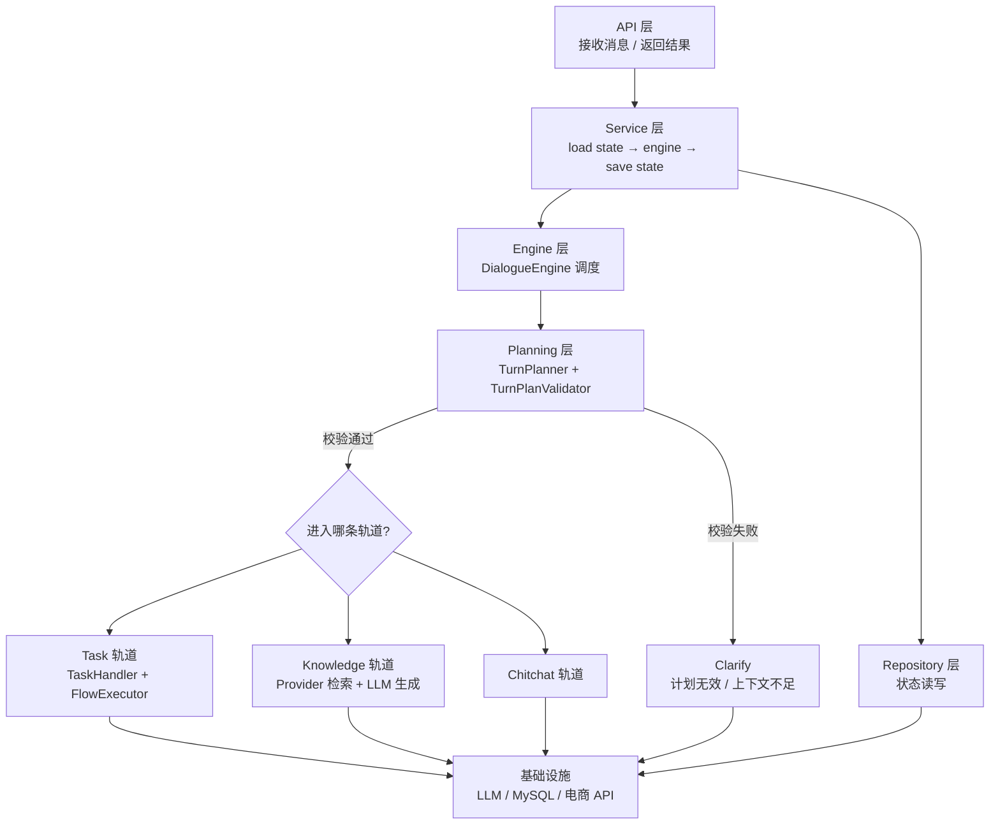
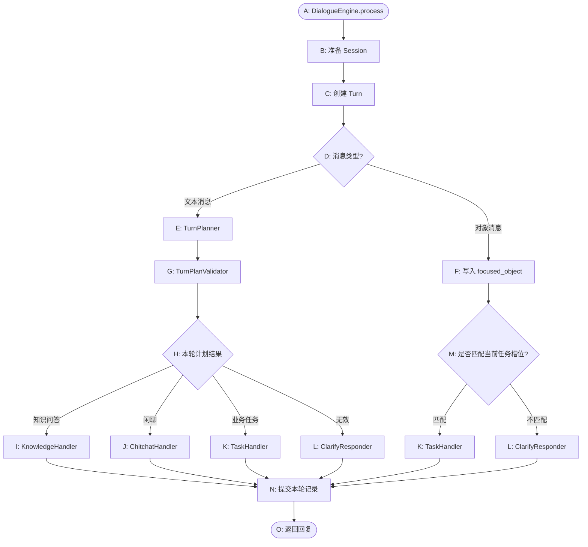

# ShopMate · 智能客服对话引擎

一套面向电商场景的智能客服后端：**用 LLM 理解用户意图，用代码执行具体动作**。

项目核心命题是：如何用工程化的方式驯服 LLM 的不确定性，让业务结果稳定可控。答案由三条设计组成：

- **结构化输出 + 校验白名单 + 澄清兜底**：LLM 只负责"理解"，能不能执行由确定性代码判断。
- **LLM 路由 + YAML 流程编排**：任务型对话不是硬编码 if-else，而是一份可配置、可热改的 Flow。
- **会话状态 + 任务栈管理**：多轮对话、任务切换、任务恢复都有明确的状态模型，并持久化到数据库。

## 能力一览

| 轨道 | 说明 | 示例 |
| --- | --- | --- |
| 任务流程 | 按 YAML 定义的步骤收集信息、调用业务接口、返回结果 | 查订单状态、查物流、申请退款、相似商品推荐、欢迎引导、转人工 |
| 信息检索 | 先检索可信知识，再让模型组织回答 | 商品信息、订单信息、退款/退货/配送政策、平台规则 |
| 闲聊 | 轻量自然对话，兜底体验 | "你好"、"你还挺聪明" |

## 整体架构



## 一条消息的完整处理流程

对应项目流程图中的 A–O 节点：



## 目录结构

```text
ecommerce-customer-service/
├─ shopmate/
│  ├─ api/                  # FastAPI 路由、请求/响应模型、依赖注入、应用生命周期
│  ├─ clients/              # LLM、数据库引擎、HTTP 客户端
│  ├─ conf/                 # pydantic-settings 配置
│  ├─ domain/               # 领域模型：消息、对话状态、任务状态、任务生命周期事件
│  ├─ models/               # SQLAlchemy ORM
│  ├─ repository/           # DialogueStateRepository（JSON 序列化 + Upsert）
│  ├─ service/              # DialogueService（一次消息处理的编排）
│  ├─ engine/               # DialogueEngine + builder（组装全部依赖）
│  ├─ plan/                 # TurnPlanner（LLM 出计划）、TurnPlanValidator（代码校验）
│  ├─ task/                 # 任务轨道
│  │  ├─ command/           #   Command 模型 + CommandProcessor
│  │  ├─ flow/              #   Flow 模型、YAML 加载、条件表达式、FlowExecutor
│  │  ├─ response/          #   回复模板 + ResponseRenderer（static/rephrase/generate）
│  │  ├─ lifecycle/         #   任务生命周期提示
│  │  ├─ action/            #   Action 基类、注册表、Runner、自动发现
│  │  │  └─ custom/         #   业务 Action（新增 Action 只需放这里）
│  │  └─ handler.py         #   TaskHandler 统一入口
│  ├─ knowledge/            # 知识轨道：Provider、Intent、Registry、Responder、Handler
│  ├─ chitchat/             # 闲聊轨道
│  ├─ clarify/              # 澄清轨道
│  ├─ prompts/              # 提示词加载器、历史构造、jinja2 模板
│  └─ flow_config/          # user_flows.yml：任务流程配置
├─ tools/mock_commerce/     # 模拟电商后端（订单/物流/商品）
├─ tests/                   # 单元测试（Flow、校验器、状态持久化、Engine）
├─ docs/ARCHITECTURE.md      # 架构说明与关键取舍
├─ docs/10-DAY-PLAN.md       # 10 天迭代计划
├─ main.py                   # 服务入口
└─ pyproject.toml
```

## 快速开始

### 1. 环境要求

- Python 3.12+
- [uv](https://docs.astral.sh/uv/)
- MySQL 8（也可用 SQLite 零依赖体验）
- 一个大模型 API Key（项目默认走阿里云百炼 OpenAI 兼容接口）

```bash
uv sync
cp .env.example .env        # Windows: copy .env.example .env
```

编辑 `.env`，至少填好 `LLM_API_KEY`。

### 2. 启动模拟电商后端（另开一个终端）

```bash
uv run python tools/mock_commerce/main.py
# 监听 http://127.0.0.1:18081
```

### 3. 初始化数据库

```bash
mysql -uroot -p -e "CREATE DATABASE IF NOT EXISTS customer_service DEFAULT CHARSET utf8mb4;"
```

服务启动时会自动建表（`AUTO_CREATE_TABLES=true`）。

如果暂时没有 MySQL，把 `.env` 里的 `DATABASE_URL` 换成：

```dotenv
DATABASE_URL=sqlite+aiosqlite:///./data/customer_service.db
```

### 4. 启动客服后端

```bash
uv run python main.py
# 监听 http://127.0.0.1:18082
```

### 5. 试一试

```bash
# 文本消息：发起查订单任务
curl -X POST http://127.0.0.1:18082/api/chat \
  -H "Content-Type: application/json" \
  -d '{"sender_id":"user_001","text":"帮我查一下订单状态","message_id":"msg_001"}'

# 补充订单号
curl -X POST http://127.0.0.1:18082/api/chat \
  -H "Content-Type: application/json" \
  -d '{"sender_id":"user_001","text":"A20240315001","message_id":"msg_002"}'

# 对象消息：点选订单卡片
curl -X POST http://127.0.0.1:18082/api/chat \
  -H "Content-Type: application/json" \
  -d '{"sender_id":"user_001","object":{"type":"order","id":"A20240315001","title":"订单 A20240315001"},"message_id":"msg_003"}'

# 聊天历史
curl "http://127.0.0.1:18082/api/chat/history?sender_id=user_001"
```

接口文档：<http://127.0.0.1:18082/docs>

## 离线演示（无需真实 LLM Key）

仓库自带一个"模拟大模型"服务，按提示词关键词返回确定性结果，用于离线演示和端到端验收：

```bash
# 终端 1：模拟电商后端
uv run python tools/mock_commerce/main.py      # 18081

# 终端 2：模拟大模型
uv run python tools/mock_llm/main.py           # 18083

# 终端 3：客服后端（指向模拟模型 + SQLite）
# Windows PowerShell:
$env:LLM_BASE_URL="http://127.0.0.1:18083/v1"; $env:LLM_API_KEY="mock"; $env:LLM_MODEL="mock"
$env:DATABASE_URL="sqlite+aiosqlite:///./data/demo.db"
uv run python -m uvicorn shopmate.api.app:app --port 18082

# 终端 4：一键跑完 8 个场景并写结果到 data/smoke/result.json
uv run python tools/smoke_check.py
```

预期结果：发起查订单 → 补订单号拿到状态 → 闲聊 → 政策咨询 → 历史记录，5 个请求全部 200。

## 接口

### `POST /api/chat`

请求体：

| 字段 | 类型 | 必填 | 说明 |
| --- | --- | --- | --- |
| `sender_id` | string | 是 | 用户唯一标识 |
| `text` | string \| null | 否 | 文本消息，`text` 与 `object` 必须且只能传一个 |
| `object` | object \| null | 否 | 结构化对象消息 |
| `message_id` | string \| null | 否 | 不传时服务端生成；同一 ID 重复提交返回相同结果（幂等） |

响应：

```json
{
  "sender_id": "user_001",
  "message_id": "msg_001",
  "messages": [
    { "text": "好的，我们先处理订单状态查询。", "object": null },
    { "text": "请告诉我你的订单号。", "object": null }
  ]
}
```

### `GET /api/chat/history?sender_id=...`

按 Session、Turn 的保存顺序展开为一维消息列表，`role` 为 `user` / `bot`。

## Flow 配置

任务流程写在 `shopmate/flow_config/user_flows.yml`，由 `slots` 与 `flows` 两部分组成。

```yaml
slots:
  order_number:
    type: text
    label: 订单号
    description: 用户的订单号

flows:
  order_status_query:
    name: 订单状态查询
    description: 帮用户查询订单当前的处理状态，需要订单号。
    steps:
      - id: start
        type: start
        next: ask_order_number

      - id: ask_order_number
        type: collect
        slot_name: order_number
        template:
          text: "请告诉我你的订单号。"
        validation:
          condition: "len(slots.get('order_number') or '') >= 4"
          failure_template:
            text: "订单号看起来不太对，请重新输入完整订单号。"
        next: lookup_order_status

      - id: lookup_order_status
        type: action
        action: action_lookup_order_status
        next: show_order_status

      - id: show_order_status
        type: response
        template:
          text: "订单{{ slots.order_number }}当前状态是：{{ slots.order_status }}。{{ slots.order_summary }}"
        next: end

      - id: end
        type: end
        next: []
```

Step 类型：

| 类型 | 作用 |
| --- | --- |
| `start` | 流程入口，只负责跳转 |
| `collect` | 收集一个 Slot；有 `validation` 时额外校验 |
| `action` | 调用 `shopmate/task/action/custom` 中注册的业务 Action |
| `response` | 渲染回复，支持 `static` / `rephrase` / `generate` |
| `end` | 任务完成，清空活动任务 |

`next` 支持直接跳转与条件跳转：

```yaml
next:
  - if: "slots.get('product_id')"
    then: recommend
  - else: ask_product
```

条件表达式运行在受限环境（仅白名单内置函数），可用 `slots` 变量。

## 扩展指南

### 新增一条任务流程

1. 在 `user_flows.yml` 的 `slots` 中声明需要的字段。
2. 在 `flows` 中新增 Flow，串好 `start → collect/action/response → end`。
3. 重启服务，Planner 会自动从 Flow 的 `description` 认识这项能力。

### 新增一个业务 Action

在 `shopmate/task/action/custom/` 下新建模块，继承 `Action`：

```python
class LookupMemberPointsAction(Action):
    name = "action_lookup_member_points"

    async def run(self, state, action_kwargs) -> ActionResult:
        ...
        return ActionResult(slot_updates={"member_points": "1280"})
```

启动时 `register_custom_actions()` 会扫描并自动注册，无需改动任何装配代码。

### 接入真实知识来源

替换 `shopmate/knowledge/providers.py` 中 `FAQProvider` / `RAGProvider` 的 `retrieve()` 实现即可，接口保持不变：

```python
async def retrieve(state, user_message) -> list[KnowledgeChunk]: ...
```

## 测试

```bash
uv run pytest -q
```

覆盖：

- Flow YAML 加载与 Step 解析、条件连接构造
- FlowExecutor 多轮推进、Slot 校验、聚焦对象补槽、任务切换
- TurnPlanValidator 的各条拒绝规则
- DialogueState 的 JSON 往返与 Upsert（SQLite）
- DialogueEngine 的文本→对象消息链路与会话超时重置
- 消息幂等（重复 `message_id` 回放）与同用户并发串行化
- HTTP 层：请求校验、历史展开、对象消息持久化

## 模块职责

| 模块 | 职责 | 主要文件 |
| --- | --- | --- |
| 配置与客户端 | 读环境变量、构造 LLM / DB / HTTP 客户端 | `shopmate/conf/`, `shopmate/clients/` |
| 领域模型 | 消息、会话、任务状态与生命周期事件 | `shopmate/domain/` |
| 持久化 | 状态 JSON 往返与 Upsert | `shopmate/repository/`, `shopmate/models/` |
| 服务编排 | 一次消息的加载 → 处理 → 保存 | `shopmate/service/dialogue_service.py` |
| 对话引擎 | 会话管理、轮次提交、文本/对象分流 | `shopmate/engine/` |
| 规划 | 生成计划、确定性校验 | `shopmate/plan/` |
| 任务轨道 | Command、Flow 引擎、Action | `shopmate/task/` |
| 知识轨道 | Provider、Intent、检索与生成 | `shopmate/knowledge/` |
| 闲聊 / 澄清 | 兜底与补问 | `shopmate/chitchat/`, `shopmate/clarify/` |
| 接口层 | 路由、依赖注入、应用生命周期 | `shopmate/api/`, `main.py` |

架构细节与设计取舍见 [docs/ARCHITECTURE.md](docs/ARCHITECTURE.md)。

## 10 天迭代计划

项目按 10 天螺旋推进，每天一个可独立验收的能力：

| 阶段 | 内容 |
| --- | --- |
| Day 1 | 欢迎引导/转人工 Flow、条件分支、规划提示词重写、Slot 白名单 |
| Day 2–4 | 消息幂等与串行化、统一错误模型、Alembic 迁移与乐观锁 || Day 5–7 | 真实 RAG（切分/向量/引用）、golden set 评估、可观测性 |
| Day 8–10 | SSE 流式 + 前端 Demo、Docker/压测、面试版 README 与 ADR |

详见 [docs/10-DAY-PLAN.md](docs/10-DAY-PLAN.md)。

## FAQ

**没有 LLM Key 能跑吗？**
纯任务流程（Flow 推进、Slot 校验、状态持久化）可以跑通，测试也是这么验证的；但文本消息要先经过 `TurnPlanner`，所以对话入口需要 Key。

**为什么 `TurnPlanValidator` 要单独存在？**
大模型只负责理解，不负责保证系统能执行。方向冲突、Flow 不存在、缺少聚焦对象这些问题必须由确定性代码拦截，否则错误会掉到下游执行层。

**对象消息为什么有时不直接执行任务？**
对象只表达了"关注什么"，没有表达"要做什么"。只有当前任务正在收集对应 Slot 时才直接补槽，否则走澄清，避免替用户猜意图。
